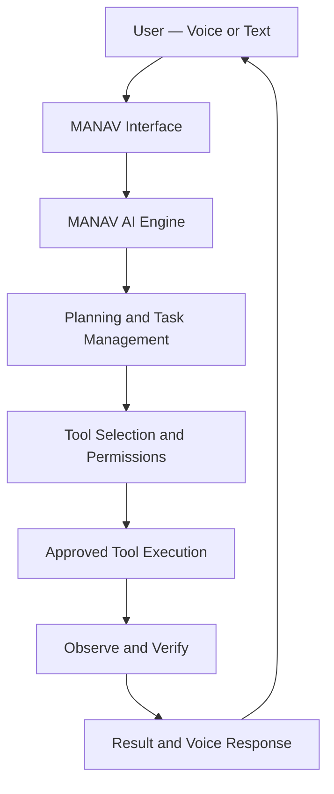

# MANAV AI

### Your voice-first autonomous AI assistant.

**Speak your objective. MANAV works toward the result.**

MANAV is an ambitious personal AI assistant project inspired by the idea of a computer that you can communicate with naturally. The long-term vision is to build a voice-first assistant that understands objectives, plans tasks, uses permitted tools on your computer, and verifies its work.

The project is currently under active development.

<p align="center">
  
  
  
  
</p>

---

## ✨ The Vision

Imagine opening your computer and saying:

> "Hey MANAV, open my project, find the error, fix it, run the tests, and tell me what you changed."

MANAV is being designed to work toward that experience.

Rather than being just another chatbot, the goal is to build an assistant that can understand an objective, develop an execution plan, use appropriate tools, observe the results, recover from errors, and report what actually happened.

## 🚀 Planned Capabilities

| Capability | Vision |
|---|---|
| 🎙️ Voice interaction | Natural speech input and spoken responses |
| 🧠 AI reasoning | Understand objectives and break them into tasks |
| ⚙️ Task execution | Execute permitted actions through a tool system |
| 💻 Computer assistance | Work with approved files, terminals, projects, and applications |
| 🌐 Web research | Research information and summarize useful findings |
| 🧑‍💻 Coding assistance | Inspect, write, debug, and test code |
| 🗂️ Project awareness | Maintain useful context about ongoing projects |
| 🔄 Verification | Check results instead of assuming an action succeeded |
| 🛡️ Permission controls | Require confirmation for sensitive or destructive actions |
| 🎨 Voice-first interface | An animated, real-time AI command center |

*These are development goals, not claims that every capability is already implemented.*

## 🏗️ Architecture

MANAV is being developed around a frontend, an AI orchestration layer, and a local computer agent.



### Technology Stack

**Frontend**
- Next.js
- React
- TypeScript
- Tailwind CSS
- Framer Motion
- Lucide React
- Zustand

**Backend**
- Python
- FastAPI
- Uvicorn
- WebSockets

**Planned components**
- Speech recognition and text-to-speech
- AI model integration
- Local computer tools
- Task orchestration and verification
- Persistent memory and project context
- Permission management and execution logs

## 🖥️ Interface Design

MANAV aims for a cinematic, modern interface rather than a conventional chatbot layout.

Design goals include:

- A central animated MANAV core
- Voice-reactive visualizations
- Dark surfaces with blue, cyan, and violet gradients
- Real-time task and tool activity
- Chat, workspace, projects, and memory views
- Responsive layouts and smooth transitions

The interface will evolve alongside the underlying AI engine.

## 📁 Project Structure

The intended structure is:

```text
manav-ai/
├── public/
├── src/
│   └── app/
│       ├── layout.tsx
│       ├── page.tsx
│       └── globals.css
├── backend/
│   └── app/
│       ├── __init__.py
│       └── main.py
├── .gitignore
├── package.json
├── package-lock.json
└── README.md
```

The structure will grow as additional agents, tools, voice services, and memory components are implemented.

## ⚡ Getting Started

### Prerequisites

Install the following:

- [Node.js](https://nodejs.org/)
- [Python](https://www.python.org/)
- [Git](https://git-scm.com/)
- [Visual Studio Code](https://code.visualstudio.com/)

### 1. Clone the repository

```bash
git clone https://github.com/YOUR-USERNAME/manav-ai.git
cd manav-ai
```

Replace `YOUR-USERNAME` with the GitHub username that owns the repository.

### 2. Install frontend dependencies

```bash
npm install
```

### 3. Start the frontend

```bash
npm run dev
```

Open [http://localhost:3000](http://localhost:3000).

### 4. Start the backend

Open a second terminal from the project root.

Create and activate a Python virtual environment:

**Windows PowerShell**

```powershell
cd backend
python -m venv .venv
.venv\Scripts\Activate.ps1
```

Install the initial backend dependencies:

```powershell
python -m pip install fastapi "uvicorn[standard]" websockets python-dotenv
```

Start the development server:

```powershell
uvicorn app.main:app --reload
```

Open [http://127.0.0.1:8000](http://127.0.0.1:8000) to check the backend.

API documentation is available at [http://127.0.0.1:8000/docs](http://127.0.0.1:8000/docs).

*The frontend and backend are separate development services. Voice interaction and AI-powered execution require further implementation and integration.*

## 🛡️ Security Principles

MANAV is intended to operate with explicit permissions and verifiable actions.

- Keep API keys and credentials out of source control.
- Store secrets in local environment files that are excluded from Git.
- Restrict file access and command execution.
- Require authorization for sensitive external actions and destructive operations.
- Treat external content as untrusted input.
- Report failures honestly and verify completed work.

**Never commit real API keys, passwords, access tokens, or private personal data.**

## 🗺️ Development Roadmap

- [x] Initialize the Next.js frontend
- [x] Establish the initial MANAV interface
- [x] Create the initial Python backend scaffold
- [ ] Connect the frontend and backend
- [ ] Implement voice input and spoken responses
- [ ] Integrate an AI model
- [ ] Build the planning and task orchestration engine
- [ ] Implement permission-controlled computer tools
- [ ] Add task execution and verification
- [ ] Develop persistent memory and project context
- [ ] Improve the interface with real-time, voice-reactive animations

The roadmap reflects the intended development sequence; individual features will be marked complete as they are implemented and tested.

## 🤝 Contributing

MANAV is an evolving project. Ideas, thoughtful feedback, bug reports, and contributions will be welcome as the repository and contribution guidelines mature.

If you want to contribute:

1. Open an issue describing the idea or problem.
2. Discuss substantial changes before implementing them.
3. Keep changes focused and document how they were tested.

## 📌 Project Status

**Early development — not production-ready.**

The current focus is establishing a maintainable frontend and backend foundation before adding advanced autonomy, voice interaction, and computer-control capabilities.

## 📄 License

No license has been selected yet. Until a license is added, all rights remain with the copyright holder; public visibility alone does not grant permission to reuse the code.

---

<p align="center">
  <strong>MANAV AI</strong><br/>
  <em>From conversation to action.</em>
</p>